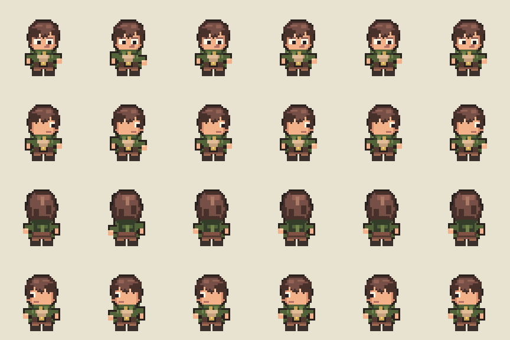

# Tales of Myrren — Main Character Asset Page

**Status:** Character identity approved; animation artwork and game integration pending QA.  
**Updated:** 14 November 2026  
**Working branch:** `feature/adventurer-v1-preview-integration`  
**Production:** The current Kez V2 renderer remains unchanged.

## 1. Visual identity — locked

The user explicitly selected the **front-facing brown-haired, olive-cloaked character shown in the 14 November chat image** as the exact main-character reference. The approved front walking preview must preserve its proportions. Do not regenerate its face or body independently in each frame.

**Do not alter:** tousled medium-brown hair silhouette; large white eyes and black pupils; right-cheek scar; warm skin; short olive-green cloak; gold clasp; beige tunic; dark belt with silver buckle; compact brown trousers/boots; short connected legs; clean dark pixel outline.

**Priority rule:** The user's latest single-character reference image and subsequently approved connected-leg walking preview override *any visually different* older generated atlas frame. The original uploaded image and approved animation preview have **not yet been committed as native source assets**. Do not claim the older atlas below is pixel-identical to the newly approved image.

## 2. Current repository assets (existing candidates, not final visual approval)

| Asset | Purpose | Status |
|---|---|---|
| [Original concept reference](../art/myrren-adventurer-v1/approved_concept_reference.webp) | Earlier preserved concept | Historical reference; verify against latest user image |
| [32×40 atlas](../art/myrren-adventurer-v1/myrren_adventurer_v1_32x40.png) | 768×160, 96-cell directional/action candidate | **Not** confirmed to match latest approved front |
| [Front frame](../art/myrren-adventurer-v1/myrren_adventurer_v1_front.png) | Prior single-frame candidate | Requires visual comparison |
| [Contact sheet](../art/myrren-adventurer-v1/myrren_adventurer_v1_review.png) | Prior QA preview | Not an animation proof |
| [Manifest](../art/myrren-adventurer-v1/myrren_adventurer_v1_manifest.json) | Frames and sockets | For prior atlas only |
| [Generator](../art/myrren-adventurer-v1/build_character.py) | Reproducible native source | Regenerate after art corrections |
| [Tests](../art/myrren-adventurer-v1/test_character.py) | Pixel and metadata checks | Rerun after regeneration |

## 3. Asset contract

- **Target frame grid:** 32 × 40 native pixels; source artwork must be authored or cleanly mapped to this grid, not blurred down from the large concept.
- **Transparency:** RGBA, binary alpha (0 or 255), no white fringe or stray pixels.
- **Shared pivot:** local (16,39); soles stay grounded and do not jump between frames.
- **Animation directions:** front, right, back, left.
- **Actions to complete:** idle, walk, punch, sword, hurt, death.
- **Leg integrity:** both legs must remain connected to the pelvis in *every* walking frame, including the far leg; no detached floating boot.
- **Visual identity:** hair, eyes, scar, clasp, waist and character width stay consistent during animation.
- **Equipment:** independent layers, dominant hand for weapon and offhand for shield; do not scale old 21×27 equipment onto the 32×40 character.
- **Gameplay:** visual-only replacement; no item-ID, combat, collision, save, or network changes.

## 4. Next implementation tasks

1. Preserve the **latest approved user image** and **approved front walk** as explicit versioned source files in this folder, with provenance and exact checksums.
2. Compare the old native front frame with the approved image and redraw the pixel source where necessary. Do not mark the old sheet approved by default.
3. Produce the remaining directions and actions using the same anchored base, then validate each frame and animated GIF at 1× and enlarged nearest-neighbour scale.
4. Generate a matching atlas and manifest; rerun pixel integrity tests and review all 4 directions.
5. Wire the new atlas into the opt-in preview only after source assets match. Keep the production renderer and old gear as fallback.
6. Capture actual in-game desktop/mobile footage for visual sign-off before changing the default character.

## 5. Implementation links

- [Full implementation handoff](CHARACTER_V1_IMPLEMENTATION_HANDOFF.md)
- [Animation contract](CHARACTER_V1_ANIMATION_ART_CONTRACT.md)
- [Existing opt-in preview adapter](../art/myrren-adventurer-v1/myrren-adventurer-v1-preview-adapter.js)

**Acceptance gate:** No merge to `main` until the latest reference is matched, feet remain connected, all frames are visually checked, and game regressions pass.
